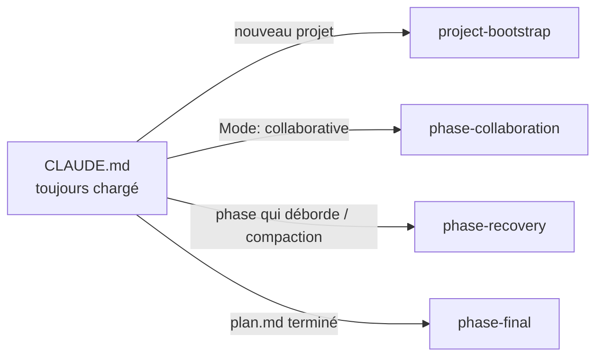
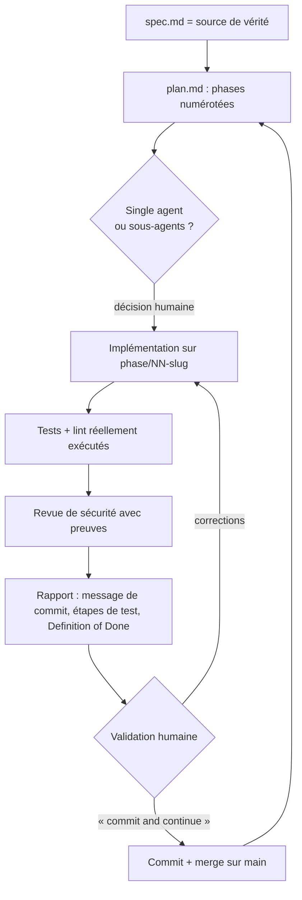

# Ma méthode : le fichier de règles pour agents IA

Le fichier de règles que j'utilise avec **Claude Code** pour développer avec des agents IA sans perdre le contrôle du projet.

L'idée : l'agent ne code pas « en roue libre ». Il suit un cycle par phases, s'arrête aux décisions qui m'appartiennent, prouve ce qu'il affirme (tests réellement exécutés, sortie collée) et ne commit jamais sans mon accord.

> Les règles sont rédigées en anglais (c'est la langue la plus fiable pour les agents). Cette page les résume en français.

## Contenu du dépôt

| Fichier | Rôle |
|---|---|
| `CLAUDE.md` | Les règles globales, chargées à chaque session |
| `skills/project-bootstrap/` | Démarrage d'un projet : discussion, `spec.md`, « grill », `plan.md` |
| `skills/phase-collaboration/` | Mode équipe : PR, revue, CI, branches poussées |
| `skills/phase-recovery/` | Phase qui déborde, phase à abandonner, reprise après compaction du contexte |
| `skills/phase-final/` | Phase finale : régression complète, sécurité, performance, test sur un clone neuf |

Le `CLAUDE.md` reste court et toujours en mémoire. Le détail des situations rares vit dans des *skills*, chargées uniquement quand leur déclencheur apparaît.



## Le cycle d'une phase



## Les principes clés

- **Pas de « yes man »** : si je me trompe, l'agent le dit, avec les arguments, puis exécute ma décision.
- **Des preuves, pas des affirmations** : « ça devrait marcher » ne compte pas, seule la sortie réelle d'une commande compte.
- **Arrêts obligatoires** : nouvelle dépendance, changement cassant, opération destructive, écart avec la spec. Toujours avec une recommandation.
- **Phases en tranches verticales** : une phrase sans « et », testable en moins de 5 minutes, réversible en un `git revert`.
- **Sécurité par déclencheurs** : pas de liste récitée, mais des vérifications avec preuve `fichier:ligne` selon ce que le code touche.
- **YAGNI** : rien qui ne soit demandé par la spec.

## Installation

Pour l'utiliser comme règles globales de Claude Code :

```sh
git clone https://github.com/walidozich/ai-agent-rules.git
cp ai-agent-rules/CLAUDE.md ~/.claude/CLAUDE.md
cp -r ai-agent-rules/skills/* ~/.claude/skills/
```

Attention : la première commande `cp` remplace votre `~/.claude/CLAUDE.md` existant. Faites une sauvegarde avant si vous en avez un.

Pour un seul projet, copiez plutôt `CLAUDE.md` à la racine du projet et les skills dans `.claude/skills/`.

Adaptez ensuite les règles à votre façon de travailler : c'est un point de départ, pas un dogme.

## Auteur

Cherchali Mohamed Walid, Lead Backend Developer.

## Licence

[MIT](LICENSE) : libre de copier, modifier et réutiliser, y compris dans un cadre commercial, en gardant la mention de copyright.
